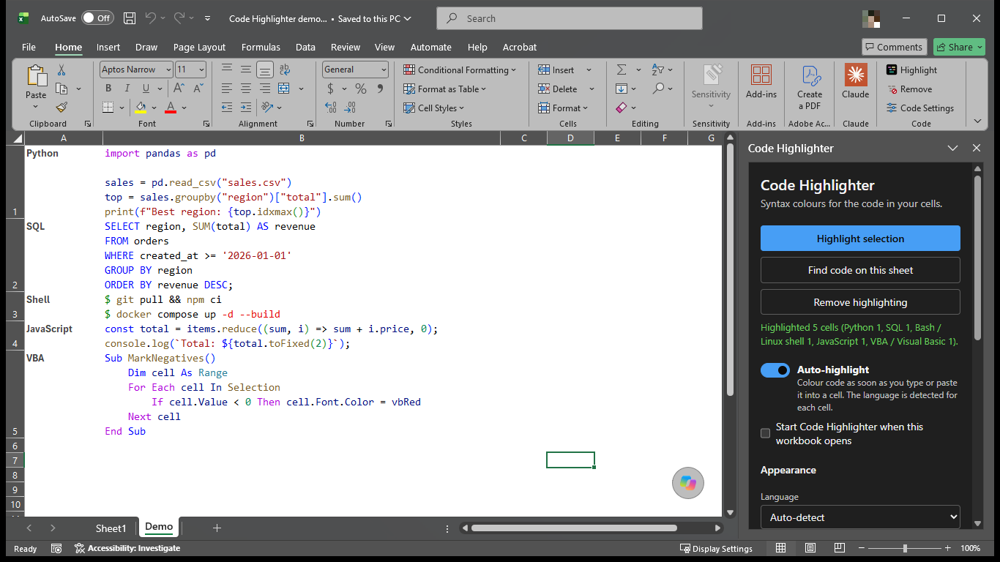

# Code Highlighter for Excel

An Office add-in that syntax-highlights code inside Excel cells in 31 languages: Python, Bash and Linux shell commands, PowerShell, Windows Batch, SQL, JavaScript, TypeScript, Java, C#, VBA / Visual Basic, C, C++, Go, Rust, Kotlin, Swift, PHP, Ruby, R, Scala, Dart, Lua, HTML/XML, CSS, JSON, YAML, TOML/INI, Markdown, Dockerfile, Terraform/HCL and diffs. It colours the text *in the cell itself* (true rich text, not a picture or text box), using Excel's `RangeTextRun` API.

- **Highlight** (Home tab): colours the code in the selected cells, detecting each cell's language unless one is chosen in Code Settings.
- **Remove** (Home tab): turns highlighted cells back to plain black text with no fill.
- **Code Settings** (Home tab): language (or auto-detect), theme (Dark+, Light+, GitHub Light, Monokai, One Dark), font, size, fill/column/row options, and **auto-highlight**, which colours any cell you type or paste code into as soon as you finish editing it.

Each language has its own hand-written lexer, so highlighting follows the real syntax: f-strings and template literals highlight the code inside them, shell commands are told apart from their flags and arguments (and terminal prompts like `user@host:~$` are dimmed), HTML colours embedded `<script>` and `<style>` blocks, and so on. Detection is deliberately cautious: ordinary notes and labels score zero and are never auto-highlighted.

Requires Microsoft 365 Excel for Windows (Version 2501+), Mac (16.93+) or Excel on the web — anything supporting ExcelApi 1.18 and the shared runtime. Excel 2024 LTSC and older perpetual versions don't support it, and Excel on iPad doesn't support the shared runtime, so the add-in isn't offered there.



## Install

Code Highlighter isn't in the Office store. Pick one of two ways to install it:

- **[Easy way](#easy-way-one-command):** paste one command; it does the setup for you.
- **[Manual way](#manual-way-step-by-step):** do the same setup yourself, step by step, without running a script.

Both end in the same place. The add-in runs from GitHub Pages, so updates arrive automatically and you only reinstall when a release says so.

### Easy way: one command

#### Windows

Open **PowerShell** (Start menu › type *PowerShell*), paste this and press Enter:

```powershell
irm https://leng-phirun.github.io/excel-code-highlighter/install.ps1 | iex
```

Choose **Yes** when Windows asks for permission. Then, once, in Excel: **Home › Add-ins › Advanced**, open the **SHARED FOLDER** tab, select **Code Highlighter** and choose **Add**. The **Code** group stays on the Home tab from then on.

The script downloads the manifest to `%USERPROFILE%\CodeHighlighter`, checks that it's Code Highlighter's and points only at this add-in's site, shares that folder as `\\localhost\CodeHighlighter` and adds it to Excel's trusted add-in catalogs: the manual way below, automated. Sharing the folder is the one step that needs permission, and the only command that runs as administrator. The share is read-only and only your account can open it. Without permission it registers Code Highlighter as a developer add-in instead, which you choose under **Home › Add-ins** each time Excel starts.

To read the script before it runs, download it, open it, then run it:

```powershell
irm https://leng-phirun.github.io/excel-code-highlighter/install.ps1 -OutFile install.ps1; notepad install.ps1
```

```powershell
powershell -ExecutionPolicy Bypass -File .\install.ps1
```

To remove it:

```powershell
irm https://leng-phirun.github.io/excel-code-highlighter/uninstall.ps1 | iex
```

#### Mac

Open Excel once, quit it, then open **Terminal**, paste this and press Return:

```bash
curl -fsSL https://leng-phirun.github.io/excel-code-highlighter/install.sh | sh
```

Open Excel and choose **Home › Add-ins › Code Highlighter**. The script checks the manifest and copies it into Excel's add-in folder; nothing runs as administrator ([script](install/install.sh)). To read it first, run `curl -fsSLO https://leng-phirun.github.io/excel-code-highlighter/install.sh`, open `install.sh`, then run `sh install.sh`. To remove the add-in, run the install command with `uninstall.sh` instead.

#### Excel on the web

There's no command for the web; it's already a single upload. See *Excel on the web* under the manual way.

### Manual way: step by step

First **[download manifest.xml](https://github.com/Leng-Phirun/excel-code-highlighter/releases/latest/download/manifest.xml)** from the [latest release](https://github.com/Leng-Phirun/excel-code-highlighter/releases/latest). It's the small file that tells Excel where the add-in lives.

#### Windows

Excel for Windows installs add-ins from a shared folder ([Microsoft's guide](https://learn.microsoft.com/office/dev/add-ins/testing/create-a-network-shared-folder-catalog-for-task-pane-and-content-add-ins)):

1. Create a folder, for example `C:\OfficeAddins`, and put `manifest.xml` in it.
2. Right-click the folder › **Properties › Sharing › Share**, choose your own account, select **Share** (Windows asks for permission), and note the network path it shows, for example `\\YOUR-PC\OfficeAddins`.
3. In Excel: **File › Options › Trust Center › Trust Center Settings › Trusted Add-in Catalogs**. Paste the network path into **Catalog Url**, select **Add catalog**, tick **Show in Menu**, and select **OK** twice.
4. Close and reopen Excel, then choose **Home › Add-ins › Advanced**, open the **SHARED FOLDER** tab, select **Code Highlighter** and choose **Add**.

To remove it: delete the catalog in the same Trust Center page, stop sharing the folder (**Properties › Sharing › Advanced Sharing**, untick **Share this folder**), delete the folder, and restart Excel.

#### Mac

1. Quit Excel.
2. In Finder press **Cmd+Shift+G** and go to `~/Library/Containers/com.microsoft.Excel/Data/Documents/wef` (create the `wef` folder if it doesn't exist).
3. Copy `manifest.xml` into it, open Excel, and choose **Home › Add-ins › Code Highlighter**.

To remove it, delete `manifest.xml` from that folder and restart Excel.

#### Excel on the web

1. Open a workbook in Excel on the web.
2. Choose **Home › Add-ins › More Settings**.
3. Select **Upload My Add-in**, **Browse** to `manifest.xml`, and select **Upload**.

Excel remembers it in that browser; after clearing the browser's data or switching browsers, upload it again.

#### Everyone in an organisation

A Microsoft 365 admin can install it for all users: **admin.microsoft.com › Settings › Integrated apps › Upload custom apps**, choose **Office Add-in**, upload `manifest.xml`, and assign it. It then appears in Excel on Windows, Mac and the web for everyone assigned.

## Project layout

| Path | What it is |
|---|---|
| `manifest.xml` | Add-in manifest (ribbon buttons, shared runtime, requirement sets) |
| `src/highlighter/types.ts` | Token types and the `Language` interface |
| `src/highlighter/scanner.ts` | Shared lexer base: emitting, quoted literals, brackets |
| `src/highlighter/languages/` | One lexer + detector per language; `index.ts` is the registry and auto-detection |
| `src/highlighter/languages/engine.ts` | One configurable lexer shared by most languages (comments, strings, interpolation, sigils, ...) |
| `src/highlighter/languages/clike.ts` | JS, TS, Java, C#, C, C++, Go, Rust, Kotlin, Swift, Scala and Dart on that engine |
| `src/highlighter/languages/scripting.ts` | PHP, Ruby, Lua, R and Terraform on that engine |
| `src/highlighter/signals.ts` | Weighted-evidence scoring used by every detector |
| `src/highlighter/themes.ts` | Colour themes |
| `src/highlighter/runs.ts` | Tokens → the fewest possible styled text runs |
| `src/excel/highlight.ts` | Reads cells and writes rich text through Office.js |
| `src/excel/auto.ts` | Auto-highlight on cell edits |
| `src/taskpane/` | Code Settings pane; also hosts the ribbon button handlers |
| `src/pages/` | Help, privacy and terms pages, linked from the add-in |
| `assets/` | Icons, generated by `npm run icons` |
| `install/` | One-command installers for Windows (PowerShell) and Mac (shell), served from GitHub Pages |
| `.github/workflows/pages.yml` | Tests, builds and deploys to GitHub Pages on every push to `main` |

## Develop

```bash
npm install
```

```bash
npm test
```

Trust the local HTTPS certificate once (Windows asks you to confirm installing a development certificate):

```bash
npx office-addin-dev-certs install
```

Start the dev server and open Excel with the add-in sideloaded:

```bash
npm start
```

Stop and unregister it:

```bash
npm run stop
```

Other scripts: `npm run typecheck`, `npm run lint`, `npm run validate` (manifest check). A production build needs the address it will be hosted at: `ADDIN_PUBLIC_URL=https://your-host/ npm run build` writes `dist/`.

## Adding another language

Add a module in `src/highlighter/languages/` exporting a `Language`: a lexer (usually a `Scanner` subclass) whose tokens reproduce the input exactly, a `score` built from `Signal`s, and a preview sample. For most languages a `define({...})` call on the shared engine (see `clike.ts` and `scripting.ts`) is enough. Register it in `languages/index.ts`; `test/languages.test.ts` then fuzzes it automatically, and you should add detection cases to `test/detect.test.ts`. Themes and the Excel layer work on token types, so they don't change.

## Publishing

See [PUBLISHING.md](PUBLISHING.md).

## License

[MIT](LICENSE)
